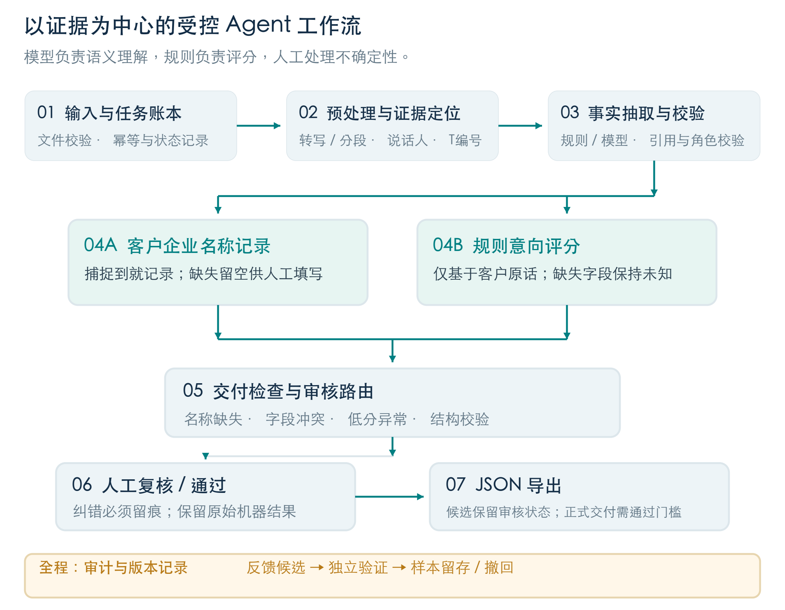

# AI SDR Agent

## 从销售通话到可审核的结构化线索

方案设计书 · 当前实现与后续演进

面向酷家乐 XDR 场景 · AI 应用开发实习生笔试项目

**设计版本：3.1 ｜ 日期：2026-10-20**

以原文约束事实，以规则解释评分，以人工确认完成业务闭环。

本文依据当前代码与已完成的产品改动整理，覆盖录音、账号、个人模型、客户资源、事实抽取、意向评分、人工审核及导出。已实现能力、历史兼容逻辑和后续规划分别说明。

**文档状态：实现同步版。** 评分规则为 intent-3.1，企业名称规则为 entity-3.0。回归测试用于验证实现行为，不代表真实通话的识别准确率；本项目为单团队、单进程的本地演示应用。

<!-- pagebreak -->

## 01 业务目标与设计取舍

### 1.1 要解决的问题

销售通话中的信息通常分散在多轮对话里：客户可能只说品牌或简称，需求夹杂在销售介绍之间，下一步安排也未必形成确定承诺。直接让模型生成一张“完整客户表”，容易把推测写成事实，并掩盖缺失信息。

本系统把文本或录音转成有依据的客户资料与销售线索候选，让销售能看到“客户说了什么、系统如何判断、还缺什么、谁确认过”。SQL 指 Sales Qualified Lead（销售合格线索），与数据库查询语言无关。

### 1.2 三个独立判断

| 判断 | 回答的问题 | 当前依据 |
|---|---|---|
| 客户资料 | 本次通话中确认了哪些事实？ | 客户侧原文、人工填写来源及字段校验 |
| 购买意向 | 当前需求的推进意愿如何？ | 需求、时间、预算、行动四维确定性评分 |
| 交付就绪 | 当前记录能否正式交付？ | 销售通话、资料完整度、意向、审核及数据模式 |

高意向不等于可交付。客户可以明确想试用，同时只留下脱敏电话；这类记录应保留高意向判断，继续补齐资料，而不是靠降低评分掩盖信息缺口。

### 1.3 核心决策

- 模型理解原文并输出带证据的字段和信号；代码负责分数、等级、审核状态及导出门槛。
- 企业名称按通话捕捉结果记录，缺失时留空。品牌或简称不扩展成工商全称，不强制企业检索。
- 未提及的维度暂计零分，同时保留 unknown；零分表示当前无有效证据时，不等同于明确否定。
- 原始输入、模型输出、校验后结果和人工修订分开保存。人工填写不能伪装成通话原话。
- 客户归属决定访问边界；管理员调配后，后续操作重新检查权限和版本。
- 自动化以可检查、可纠正为前提。反馈进入待验证队列，不承诺“改一次便自动训练”。

### 1.4 当前交付范围

已实现文本分析、录音上传与分片转写、角色确认、客户识别与关联、员工独立模型配置、客户调配、单条与批量审核、独立复核、反馈管理、JSON/CSV 导出及回归评测。

电话挂断后自动同步、正式 CRM 写入、真实业务盲测、企业 SSO、多租户和分布式任务队列均未实现。企查查 MCP 在本地仅完成连接与工具列表验证，当前自动分析不调用它。

<!-- pagebreak -->

## 02 系统架构与工程选择

### 2.1 当前架构



采用显式 Python 工作流：任务主干固定，理解节点允许调用模型，证据、权限、状态和输出由程序约束。模型不拥有自主执行命令、修改业务规则或任意调用外部工具的权限。

### 2.2 技术栈

| 层次 | 选择与职责 | 选择原因 |
|---|---|---|
| 服务端 | Python 3.11+、FastAPI、Uvicorn、Pydantic | API 与结构化契约明确，便于本地运行和验证 |
| 前端 | 原生 HTML / CSS / JavaScript | 无 npm 构建步骤，支持原文对照和审核交互 |
| 模型传输 | httpx；个人语音模型与文字模型分开配置 | 避免用同一接口混用 ASR 与文字理解 |
| 后台任务 | Python 进程内线程池 | 满足单机演示，任务状态持久化以便观察 |
| 存储 | SQLite、私有 var 目录 | 保存账号、客户、录音、分析、修订与审计 |
| 音频 | mutagen、imageio-ffmpeg | 时长识别、解码、标准化和长录音切片 |
| 凭据 | cryptography 加密个人模型密钥 | 服务端保存，页面不回显明文 |

没有引入 LangGraph、Streamlit 或飞书数据库。仓库中保留的拼音匹配、企业目录和 HTTP 检索适配器属于历史兼容能力，不是当前名称记录链路的必经节点。

<!-- pagebreak -->

## 03 输入、录音与角色确认

### 3.1 两条入口

文本入口直接提交带销售／客户标签的通话，以及可选通话元数据。录音入口先完成上传、转写、客户关联和角色确认，再把确认稿送入同一分析工作流。

录音支持选择已有客户，或由文字模型从转写中识别客户线索。AI 路径中的建议仅帮助匹配：用户必须确认关联已有客户或创建新档案；不会仅凭名称相近自动跨负责人合并客户。

### 3.2 长录音处理

| 步骤 | 处理 | 边界 |
|---|---|---|
| 上传 | WAV、MP3、M4A、FLAC、OGG | 单文件最大 200 MiB、60 分钟，总配额 2 GiB |
| 标准化 | 解码成 16 kHz 单声道 PCM | 文件可上传不等于第三方模型必然能识别 |
| 切片 | 每片不超过 180 秒，优先靠近静音处分割 | 按音频顺序保存和合并 |
| 转写 | 语音模型执行 ASR，保存片段与任务状态 | 支持片段重试，仍受厂商额度和网络约束 |
| 校对 | 显示原文、角色建议和人工确认稿 | 分片转写不能消除口音、噪声和重叠说话误差 |

### 3.3 角色整理与保真

常用链路为 Qwen ASR 加文字模型推断销售／客户角色。它根据文本语义整理角色，不等同于声学说话人识别。已有声学 diarize 适配与接口契约测试，但尚未用真实 OpenAI 凭据完成联调。

角色包括销售、客户、其他、存疑。原文单元编号及覆盖校验用于检查整理过程是否增删或改写内容；其他与存疑原文保留展示，但不进入客户事实证据。分析前必须逐条处理角色、保存确认稿，不得存在“待确认”，且至少有一段确认的客户发言。

系统自动将整段纯语气词、重复短应答，以及开头符合规则的“家乐来电／酷家乐来电”归为其他。例：“嗯”“对对对”可以自动排除；“对对，预算五万”“喂，我们想试用”含业务信息，不整段排除。单独“对”“好的”仍可能承载确认，不能一概过滤。

开场播报目前使用原文起点小于 40 字符及整段匹配的启发式。自动规则依赖文本单元边界，重复短应答也可能承载语义，因此保留人工检查。已保存的确认稿不会被新规则自动覆盖。

<!-- pagebreak -->

## 04 事实抽取与证据校验

### 4.1 分析节点

| 节点 | 输入／主要处理 | 输出与失败去向 |
|---|---|---|
| 分段 | 保留销售、客户及其他角色，生成轮次编号 | 可定位的通话原文 |
| 理解 | 离线规则或文字模型抽取字段、通话类型、四维信号 | 原始抽取快照；模型失败明确记录 |
| 校验 | Schema、连续引用、角色归属、字段口径、否定与条件句 | 校验后事实及问题清单 |
| 企业名称 | 优先 raw_company，否则 brand_name | captured 或 missing，不调用企业搜索 |
| 评分 | 读取经校验信号，执行 intent-3.1 | 单一总分、等级、证据覆盖率 |
| 路由 | 检查资料、异常、拒联、修订及审核状态 | 待审原因、阻断项、候选与交付状态 |

### 4.2 Prompt 的职责

主抽取提示词位于 prompts/extract_v2.md。它要求模型只返回符合 Extraction Schema 的 JSON，不输出最终分数；每个非空事实和非 unknown 信号附 turn_id 与逐字连续引用。客户对销售问句明确确认时，需要同时保留提问和确认的依据。

转写文本属于业务数据，其中的“忽略规则”“改成高意向”等内容不能成为系统指令。模型没有工具调用权限；外部通话内容不能直接触发执行命令、发布反馈或导出正式线索。

角色整理和客户识别分别使用独立提示词，避免把事实抽取、角色判定与身份归属混成一个不可检查的回答。

### 4.3 字段保护规则

- “张总”可以作为已确认称谓，但不证明其职位是总经理或采购负责人。
- “设计部约 15 人”只支持部门人数，不支持 shejishi=15；设计师人数未提及则为 null。
- “一年几万元可以接受”支持预算范围，不代表已审批；“预算没批”也不等于没有预算。
- 客户未确认的销售产品介绍，不能进入需求摘要。
- 电话保留原本的脱敏形式，不补造缺失数字；经营地区不能从品牌总部地址推断。
- call_time 仅取明确提供的通话元数据，不能拿上传时间代替。

校验是确定性防错规则，不是通用语义证明器。复杂否定、跨轮矛盾、嘈杂录音及多方对话仍需要模型与人工判断。原始抽取与校验后结果分别保存，便于解释哪些字段被撤回。

<!-- pagebreak -->

## 05 企业名称记录策略

### 5.1 当前定义

company_name 表示本次通话中捕捉到或由人工填写的客户企业／品牌称呼。它是业务记录名称，可以是简称或品牌，不自动宣称为已核验的法律主体。

当前路径为：经过证据校验的 raw_company 非空则直接使用；否则使用 brand_name；两者都没有则留空。不得因为熟悉某个品牌而补写工商全称，也不为了凑齐字段而把销售所在企业写成客户企业。

| 状态 | company_name | 后续 |
|---|---|---|
| captured · 来自通话 | 保留客户口述名称 | 可继续审核，无需工商检索 |
| manual · 人工填写 | 人工填写或订正的名称 | 保留操作者、时间与修订 |
| missing · 缺失 | null | 提示补填；正式交付仍受资料门槛约束 |

captured 和 manual 的 verified_registry 均为 false。名称非空后，不因缺少工商核验而阻断；但客户电话、联系人、行业、意向和审核条件仍需分别满足。

### 5.2 人工填写

审核页支持填写、订正和清空名称。单独修改 company_name 不要求证据轮次、来源链接或审核理由，也不会自动触发企业双人核验。该便利规则只针对名称字段；其他事实修正与意向定性仍遵守各自证据及复核要求。

### 5.3 历史兼容与外部接口

旧版 verified 结果保留原版本及来源信息，正式导出时仍检查其历史来源有效性。新分析采用 entity-3.0，不自动重算旧记录。

企查查 MCP 仅在本地完成握手与工具列表验证，没有接入自动分析，也没有为此调用企业查询发送客户通话。旧 HTTP JSON 企业适配器与 MCP 是不同接口契约，不能直接替换 URL 当作已集成。若未来业务需要签约主体核验，应设计独立流程，而不是改变当前名称字段含义。

<!-- pagebreak -->

## 06 意向评分：intent-3.1

### 6.1 四维评分卡

总分为 N + T + B + E，上限 100 分。每维只取一个经校验的档位；模型提供信号，程序计算分数。

| 维度 | 权重 | 允许档位及含义 |
|---|---|---|
| N 需求 | 35 | 0 明确无需求；15 泛泛了解；25 具体问题；35 问题及受影响工作环节 |
| T 时间 | 25 | 0 明确无计划；10 三个月后；20 一至三个月／下月试用期望；25 明确一个月内窗口 |
| B 预算 | 20 | 0 无支出安排；10 愿讨论付费；15 可接受范围；20 已审批且覆盖报价 |
| E 行动 | 20 | 0 仅礼貌回应；5 具体联系渠道；10 主动索要方案并提问；20 日期及参与者已确认 |

未提及或没有有效证据的维度为 unknown，暂计 0 分，记录在 unknown_dimensions 中。页面显示确定总分及证据覆盖率，不再根据缺失维度推算潜在上限。兼容字段 interval=[total,total] 仅供旧接口使用。

### 6.2 等级与异常

| 场景 | 判断与动作 |
|---|---|
| 高意向 | 总分 ≥60，N≥25，且 T≥20 或 E=20 |
| 中意向 | 总分 ≥30，但未满足高意向全部条件 |
| 低意向 | 总分大于 5 且小于 30 |
| 异常 | 0–5 分，包含恰好 5 分；逐条核听并由人工定性 |

总分达到 60 不保证高意向，需求和推进条件也必须满足。规模、称谓或是否使用竞品不直接增加意向分数；已有竞品但想替换，仍按当前需求评价。

### 6.3 优先策略

明确拒联或拒绝优先于普通评分，不能通过人工改成高意向绕过。售后、无效和未知通话分别进入不适用或信息不足分支；未消解冲突保留待判断状态。没有足够依据时允许 intent.level=null、lead=null，不强行生成三个等级之一。

当前低分人工定性标记的条件为 total<=5 且不存在拒联／拒绝策略，因此某些非销售低分记录也可能带该标记。这是实际实现边界，尚未为所有售后例外分别制定规则。

### 6.4 人工定性

异常逐条提供核听声明及客户证据或可追溯来源，保留机器原始分数，并交由不同账号独立复核。审核理由选填不代表证据可省略。批量修改等级不能替代异常逐条核听。

核听目前以人工勾选声明为依据，没有验证实际收听时长。人工等级是修订结果，不能包装成原始算法判定，也不能因此抹去 unknown 或原始证据不足。

<!-- pagebreak -->

## 07 输出契约与题目样例

### 7.1 十五个业务字段

| 字段 | 类型 | 规则 |
|---|---|---|
| company_name | string / null | 通话捕捉或人工填写的名称，不等同工商认证主体 |
| industry | string / null | 客户行业，缺失保持空值 |
| area | string / null | 客户经营地区 |
| contact_name | string / null | 有依据的姓名或称谓 |
| contact_title | string / null | 明确职位，不从“某总”推断 |
| phone | string / null | 保留脱敏形态，不补数字 |
| intent_level | high / medium / low | 无有效等级时不生成完整 lead |
| intent_reason | string | 规则解释及证据轮次 |
| demand_summary | string / null | 客户现状、问题与目标 |
| mendian | integer / null | 明确门店数量 |
| shejishi | integer / null | 明确设计师数量，不等同部门人数 |
| call_time | ISO 8601 / null | 明确提供的通话时间 |
| next_action | string | 跟进建议，不自动执行外联 |
| confidence_score | number | 启发式质量指标，非校准概率 |
| need_human_review | boolean | 结合资料、证据及审核状态 |

导出增加 _meta，保留数据模式、是否有 lead、审核状态、证据和版本。没有 lead 的记录也可以导出候选诊断信息，不能把空结果伪装成正式销售线索。

### 7.2 题目样例走读

“木里木外”作为客户口述名称直接记录。客户明确提出出图慢和工厂对接问题，需求计 35；希望下月试用，时间计 20；一年几万元可接受，预算计 15；同意按给出的号码添加联系，行动计 5。总分 75，满足高意向条件。

该样例 company_name 为“木里木外”，contact_title、shejishi、call_time 均为 null；设计部约 15 人保存在扩展事实，不能代填设计师人数。phone 保留 138xxxx1234，因此仍不能作为可直接联系的正式线索。

这个结果同时表达“意向明确”和“联系资料不完整”。工商核验不再是该样例的待办，真正需要补齐的是可用联系方式及其他实际缺失项。

### 7.3 正式导出门槛

正式导出需要真实数据模式且 production_eligible 为真、delivery_status 为 ready。就绪判断包含销售场景、非低意向、企业名称、可用完整手机号、联系人和行业；不存在未处理的证据错误、抽取失败、低分异常或待独立复核，并满足审核策略。

默认关闭自动发布。演示数据即使审核通过，也只能作为候选示例，不会变成真实正式 SQL。历史 verified 企业记录额外保留来源有效性检查；新 captured/manual 名称没有强制工商核验要求。

<!-- pagebreak -->

## 08 人工审核与反馈闭环

### 8.1 审核体验

审核页把原文、字段、四维证据、缺失项与操作放在同一流程中。操作者可以定位原文、保存草稿、暂缓、排除、批准，或订正字段、信号和意向。界面展示机器结果与人工结果的差异。

队列优先级为：异常 → 待独立复核 → 审核中 → 待审核 → 待补证 → 分析中 → 已通过 → 已排除 → 无需审核。异常优先暴露，避免只处理高分记录而遗漏技术失败或信息异常。

### 8.2 独立复核与批量事务

| 操作 | 状态变化与约束 |
|---|---|
| 普通字段修正 | 保留原文证据或可追溯来源；外部来源支持的高影响修正进入复核 |
| 企业名称填写 | 单独填写可直接保存，不要求来源或理由，不自动触发企业双人核验 |
| 异常意向定性 | 逐条核听声明与证据，保留机器分数，不同账号复核 |
| 单条／批量审核 | 审核理由选填；权限、证据和业务门槛继续检查 |
| 批量预览 | 无固定业务条数上限，预览有效期 5 分钟 |
| 批量提交 | 一次性预览；逐条重查权限、修订号和门槛，任一失败整批回滚 |

移除条数限制不等于无限吞吐。当前仍是单机同步预览和 SQLite 事务，未做超大批量性能及内存压测。

### 8.3 可追溯反馈

修正可生成反馈候选，由独立管理员验证发布或撤回。字段、信号和意向反馈作为已审核样本保存，不自动修改 Prompt、阈值或训练模型。

历史别名功能保留范围约束，但当前企业名称路径直接采用通话名称，不依赖别名召回。未来启用任何自动策略更新前，需要冻结评测集、回归、版本发布和回滚设计，避免把一次人工选择扩散成全局错误。

<!-- pagebreak -->

## 09 账号、客户资源与数据生命周期

### 9.1 权限模型

系统提供员工和管理员角色。员工仅访问自己负责客户的录音、分析、审核、导出和统计，以及自己上传的待确认归属录音；管理员管理全部客户和账号。客户负责人不是普通可编辑字段，转交由管理员调配流程完成。

密码账号、HttpOnly 会话与写请求 CSRF 检查共同保护访问。后端校验权限，不能依赖前端隐藏按钮。客户转交后，旧负责人后续访问被撤销；写操作还要校验最新修订号，旧版本返回冲突而非覆盖他人更新。

### 9.2 每员工独立模型

员工分别配置语音模型与文字模型及各自 API Key。ASR 使用语音模型；客户身份提取、角色整理与事实抽取使用文字模型。也可以显式选择工作区默认设置。

密钥加密保存在服务端，页面不回显；任务使用启动时的配置快照与版本约束。支持厂商适配不等于已经用各厂商真实凭据验证全部功能。连接测试成功也不保证长音频、余额、所有模型和说话人能力可用。

### 9.3 编辑和删除

客户资源页可以编辑名称、联系人、电话和备注，不改写历史通话事实。操作检查权限与客户修订号，并保留管理审计。账号变更及客户调配的理由规则不因“审核理由选填”而取消。

| 对象 | 删除条件 | 删除后的保留边界 |
|---|---|---|
| 分析 | 有权限、修订一致、任务未运行 | 删除该分析、审核历史及反馈；保留客户和原始录音 |
| 录音 | 无关联分析，无执行中的任务 | 删除录音须先解除分析依赖 |
| 客户 | 无关联分析和录音 | 不级联清空；历史管理事件保留并解除客户外键 |

当前没有回收站、软删除或一键清空客户全部资料功能。需要完整清理时，按分析、录音、空客户的依赖顺序操作。

<!-- pagebreak -->

## 10 持久化、接口与运行约束

### 10.1 版本与状态

分析状态为 queued → running → completed / failed。进程重启会把未完成任务标记为 interrupted，保留输入和阶段信息；重新分析创建新任务，不承诺节点级自动恢复。音频片段重试是另一条能力，不能混写为分析状态机支持全部断点续跑。

数据库分别保存原始分析 original、当前 result、修订号、审核 events 和反馈。操作在事务中更新；历史分析保留其规则版本，不自动重算已有人工确认稿。

### 10.2 主要接口

| 操作 | 契约 |
|---|---|
| 会话 | /api/auth/login、/api/auth/logout、/api/auth/me |
| 个人模型 | /api/model-settings；/api/model-settings/test |
| 客户与调配 | /api/customers；/api/customers/{id}；/api/admin/assignments |
| 录音 | /api/transcriptions；身份确认、角色确认、重试等子接口 |
| 分析 | POST /api/analyses；GET / DELETE /api/analyses/{id} |
| 审核 | /api/reviews/{id}；/api/reviews/batch/preview 与 /commit |
| 导出 | /api/exports/{id}?kind=candidate 或 qualified；/api/export.csv |

具体请求 Schema 由运行中的 /openapi.json 提供。写请求需会话与 CSRF，涉及修订时传 expected_revision。分析幂等键至少 8 位，同账号同键同输入复用任务，同键不同输入返回冲突。

### 10.3 部署边界

默认监听 127.0.0.1:8765，只运行一个 Uvicorn 进程，不使用多个 worker。分析线程池并发为 3，待处理上限 20，输入最多 100000 字符。长文本理解仍为一次抽取调用，尚未实现跨片语义合并。

var 为私有运行目录。备份需要同时保留 SQLite、相关录音和 model-settings.key，否则恢复后可能无法解密个人模型密钥。代码交付不包含运行库、密钥、真实录音、日志和本机交接文件。

若未来需要公网运行，须单独完成 HTTPS、会话安全、备份恢复、配额监控和持久队列设计。当前 GitHub 源码发布不等同于公网服务部署。

<!-- pagebreak -->

## 11 验证方案与效果边界

### 11.1 当前可复现检查

Python 测试覆盖评分边界、企业直取、引用校验、账号权限、客户调配、客户删改、审核事务、录音流程与模型接口契约；前端测试覆盖角色确认和已确认稿保护。合成规则评测覆盖典型需求、信息缺失、拒联、冲突及非销售场景。

```bash
.venv/bin/python -m pytest -q
node --test tests/test_audio_confirmation.cjs
node --check static/app.js
node --check static/team.js
node --check static/audio-roles.js
.venv/bin/python scripts/evaluate.py
```

以上默认检查使用本地、模拟或合成数据。真实模型 smoke 和 evaluate.py --mode llm 为单独的显式调用，不属于普通回归。本轮实际结果记录在 docs/验收记录.md。

### 11.2 应如何衡量业务效果

后续应在授权数据上建立独立标注集，分别评估转写错误、角色归属、字段准确率与覆盖率、意向等级混淆、拒联漏判及人工处理耗时。高精度但几乎不输出字段，不代表业务可用；因此准确率须结合覆盖率和样本规模报告。

confidence_score 当前取企业名称、意向和字段质量的最小值，是启发式审核参考，不是“该结果正确的概率”。合成用例通过率不能推导真实业务准确率，同一模型复核自己的角色判断也不能替代人工独立标注。

### 11.3 已知限制

- 没有完成真实通话独立盲测；各模型、口音和行业场景的识别效果仍待测量。
- 自动其他规则可能误排有语义的短应答，前后端需同步维护。
- 没有完整的证据到音频时间戳跳转，也没有实际收听时长验证。
- 技术失败与低分异常共用“分析异常”队列，部分列表短标签仍待完善。
- 没有专职审核员角色、自动审核任务分派、补证截止提醒或自动备份。
- 历史截图、报告和录屏脚本反映各自生成时状态；旧分数或旧名称规则不应当作当前验收预期。

<!-- pagebreak -->

## 12 后续演进：电话结束后自动入库

### 12.1 目标与前置条件

目标是在电话结束后自动带入客户号码、录音和坐席信息，减少手工上传与关联。该功能仍为方案，尚未接入电话厂商。实施前需明确外呼系统或手机方案、管理员权限、事件或查询接口及录音获取条件。

### 12.2 建议链路

1. 接收通话结束事件，按厂商通话 ID 建立记录；录音稍后可用时补齐，不能假设两个事件同时到达。
2. 记录方向、主被叫号码、坐席、通话时间及录音 ID；依据呼入／呼出方向识别客户号码。
3. 用坐席映射员工，并在授权范围匹配客户。唯一匹配可关联，无匹配建待确认记录，多匹配或跨负责人情况进入人工确认。
4. 录音获取后触发既有转写、角色整理和确认流程，继续保留事实证据与审核门槛。
5. 对事件做鉴权、幂等、防重与失败补拉；无 Webhook 时评估定时增量查询。
6. 若厂商提供分离音轨，评估用坐席／客户通道作为角色来源，降低文本猜测依赖。

本地回环地址不能直接接收外部回调，需结合电话系统选择本地拉取或经授权部署接收服务。在具体系统与权限未明确前，不承诺任意手机都可实现挂断即上传。

### 12.3 迭代顺序

先获取电话平台接入条件并实现可靠入库，再用授权样本评估转写和角色质量；在冻结评测集上调整 Prompt、评分与复核流程。持久队列、监控、备份和组织级权限应随真实规模逐步补齐。

企业工商核验仅在业务重新提出时作为独立可选能力评估。当前优先保证名称不编造、评分可解释、人工修改可追溯，以及销售能持续使用同一条完整处理链路。

<!-- pagebreak -->

## 附录 实现文件索引与版本口径

| 文件／目录 | 主要职责 |
|---|---|
| sdr/engine.py | 文本分析编排、企业名称直取、审核阻断与输出 |
| sdr/scoring.py | intent-3.1 档位、等级、未知与异常 |
| sdr/validation.py、prompts/ | 引用校验、字段规则和模型任务定义 |
| sdr/entities.py | entity-3.0 名称记录及保留的历史适配 |
| sdr/audio.py、audio_processing.py、audio_roles.py | 录音、分片、角色保真与人工确认 |
| sdr/model_settings.py、model_transport.py | 个人模型配置、加密与传输 |
| sdr/review.py、store.py | 审核修订、批量事务、审计与反馈 |
| sdr/auth.py、workspace.py | 账号、客户归属、编辑删除与调配 |
| static/ | 中文工作台、角色确认和客户资源交互 |
| tests/、eval/ | 自动化验证及合成回归 |

项目包版本仍为 0.2.0；本设计书 3.1、评分 intent-3.1、企业名称 entity-3.0 分别管理不同对象，不互相替代。本稿统一替代早期“实施前设计”的当前说明，旧结果按自己的版本解释。
